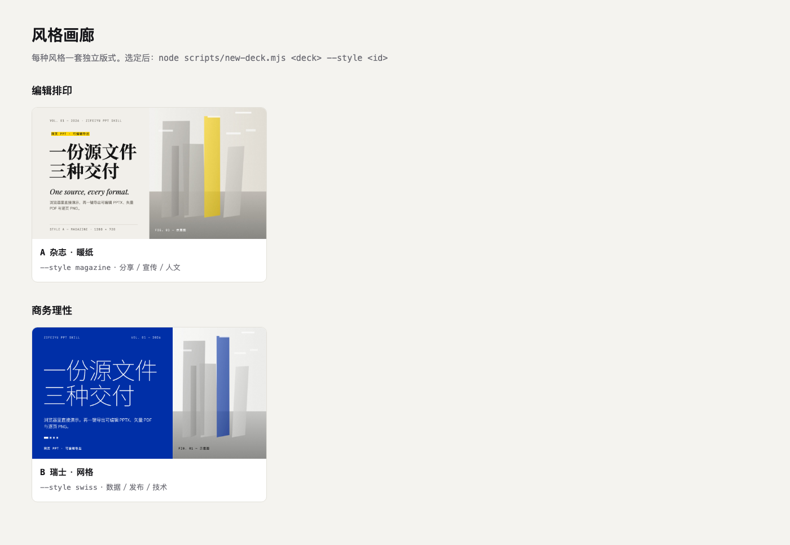

# zifeiyu-ppt-skill

> Design-locked HTML slide decks with **deterministic export to editable PPTX** — an agent skill for Claude Code, Codex, and other file-capable coding agents.
>
> [中文文档](README.md)

The one-line difference from similar projects: beautiful HTML decks usually can't become editable `.pptx` files, and generic HTML→PPTX translators are too fragile. This skill achieves both through **independent style packages + measurement-driven mapping**: every slide declares a registered `data-layout` and `data-role`, and the exporter measures actual rendered geometry in Chromium to emit deterministic `pptxgenjs` calls (1280×720 px → 960×540 pt) that are regression-tested against golden baselines.

## Style Library (8 `ready` styles · 139 registered layouts)

12 styles are delivered in phases ([style library spec](docs/superpowers/specs/2026-10-08-style-library-design.md)). **P1 + P2 (8 full styles)** are shipped and verified `ready`, each with its own independent layout geometry and typography. Browse, filter, and compare all styles side by side in the interactive gallery at [docs/styles/index.html](docs/styles/index.html):

| Style | ID | Group | Layouts | Visual DNA | Best For |
|---|---|---|---|---|---|
| **A Magazine** | `magazine` | Editorial | 18 | Warm paper, Source Han Serif display, Playfair italic figures, single lemon-yellow accent | Talks, promos, culture |
| **B Swiss** | `swiss` | Rational | 17 | Ultra-thin sans giant figures, Klein blue accent, strict grid blocks, light/blue/ink states | Data, launches, tech |
| **C Keynote** | `keynote` | Stage | 18 | Near-black ground, full-bleed dim photos, centered giant type, warm amber accent, dark rounded cards | Pitches, keynotes, big screens |
| **D Broadsheet** | `broadsheet` | Editorial | 17 | Warm newsprint, double-rule masthead, vertical column dividers, heavy serif heads, crimson rubrics | Executive reports, dense briefs |
| **E Poster** | `poster` | Stage | 17 | Acid lime / pitch black / off-white brutalist triad, full-width bold type, hard-shadow photo blocks | Recruiting, events, communities |
| **F Soft** | `soft` | Rational | 17 | Soft gray ground, white rounded cards, warm orange accent, floating stat cards, connected step dots | Product intros, proposals |
| **G Photobook** | `photobook` | Visual | 18 | Photography-first layouts, filmstrip cover, captions over translucent dark bands | Spaces, annual reviews, lookbooks |
| **H Consulting** | `consulting` | Rational | 17 | Tracker label + takeaway title + numbered exhibits + sources, deep navy + bright blue, chevron flows | Consulting, strategy, due diligence |



## Key Features

- **Style packages × 20 semantic roles** — 12 mandatory core roles (`cover`, `agenda`, `section`, `statement`, `kpi`, `compare`, `points`, `process`, `timeline`, `image`, `image-text`, `closing`) plus 8 specialized roles (`bars`, `table`, `gallery`, `cycle`, `matrix`, `system`, `video`, `audio`). Validators, exporters, and animations read role/data declarations instead of style-specific class names.
- **Four-format delivery chain** — HTML presentation → editable PPTX (`--native-charts` for native bar charts, experimental `--embed-fonts`) → vector PDF → per-slide PNG, with HTML as the single source of truth.
- **Three machine quality gates** — Playwright validator **R1–R16** (layout registry, class whitelist, overflow with graduated fix hints, 16px font floor, text collision, sourced data & bar proportionality, contrast floor, media contracts, rhythm, PPTX export fidelity); `check-style` for style package integrity; `check-pptx` OOXML artifact verification; plus golden pixel regression (`npm run regress`).
- **Deterministic font subsets** — Source Han Sans VF, Source Han Serif, Inter, Playfair Display, and JetBrains Mono are sliced to each deck's exact glyphs as `.woff2` files that travel with the deck (`file://` ready).
- **Video & audio as first-class citizens** — `<video>` / `<audio>` are measured, validated, animated, and embedded natively into PPTX (with poster-locked frames for PDF and PNG renders).
- **Interactive style gallery** — [docs/styles/index.html](docs/styles/index.html) supports group/occasion filtering, one-click command copy, multi-slide golden lightbox previews, and cross-style same-role comparison.
- **Presenter console & post-delivery edits** — press `S` for a dual-window BroadcastChannel presenter console; open `index.html?edit=1` to edit text in place with layout lock; extract brand tokens from any corporate `.pptx` via `import-theme.mjs`.

## Install

```bash
npx skills add https://github.com/ye4wzp/zifeiyu-ppt-skill --skill zifeiyu-ppt-skill
# or
git clone https://github.com/ye4wzp/zifeiyu-ppt-skill ~/.claude/skills/zifeiyu-ppt-skill
cd ~/.claude/skills/zifeiyu-ppt-skill && npm install
```

Requires Node.js ≥ 18 and `npx playwright install chromium-headless-shell`. Fetch SIL OFL source fonts once with `node scripts/fetch-fonts.mjs` (optional; falls back to system fonts). LibreOffice + poppler are optional for PPTX-side geometry verification.

## Usage

Ask your agent to "make a deck about X" to enter the 8-step workflow: clarify & pick tier → choose style from gallery → verify facts → scaffold → 2-slide sample gate → batch author → validate → visual check & export.

```bash
node scripts/new-deck.mjs <deck-dir> --style soft       # scaffold a self-contained deck
node scripts/subset-fonts.mjs <deck-dir>                # generate deck-local webfont subsets
node scripts/validate.mjs <deck-dir> [--office]         # machine gate R1–R16
node scripts/render-png.mjs <deck-dir>                  # per-slide PNG renders
node scripts/export-pdf.mjs <deck-dir>                  # vector PDF (960×540pt)
node scripts/export-pptx.mjs <deck-dir> --native-charts # editable PPTX (optional --embed-fonts)
node scripts/check-pptx.mjs <deck-dir>/deck.pptx        # OOXML artifact gate
node scripts/style-gallery.mjs                          # rebuild interactive gallery & gallery.png
node scripts/sync-skill.mjs [--check]                   # sync/verify ~/.claude/skills & ~/.agents/skills
npm test && npm run regress                             # unit tests + golden pixel regression
```

Presentation keys: arrows to navigate · `F` fullscreen · `S` presenter console.

## Known Limits

- By default, PPTX export maps web fonts to ubiquitous Office faces declared in each style's `manifest.json` (`Microsoft YaHei` / `SimSun` / `Segoe UI`) for cross-machine fidelity; `--embed-fonts` is experimental (see [references/pptx-export.md](references/pptx-export.md)).
- Not intended for large data tables or multi-user live editing.

## Credits

Methodology inspired by (independently implemented, no code reused):
[guizang-ppt-skill](https://github.com/op7418/guizang-ppt-skill) ·
[huashu-design](https://github.com/alchaincyf/huashu-design) ·
[html-ppt-skill](https://github.com/lewislulu/html-ppt-skill) ·
[guizang-social-card-skill](https://github.com/op7418/guizang-social-card-skill)

## License

[MIT](LICENSE)
