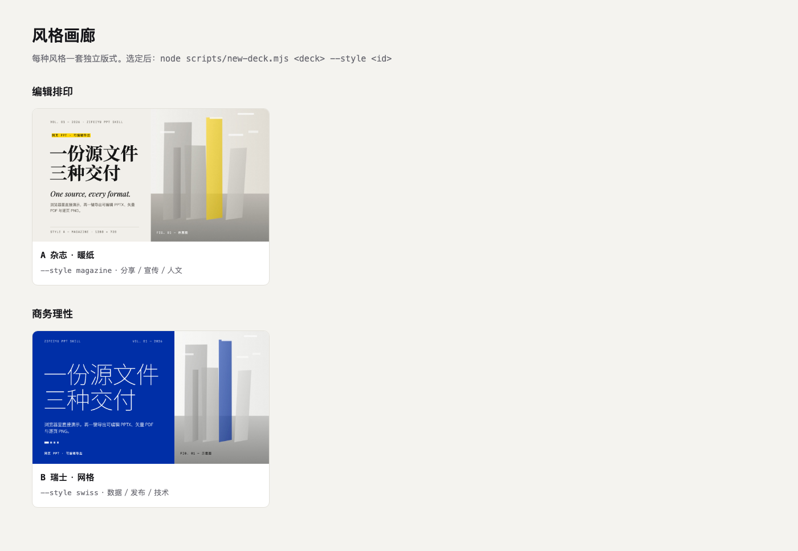
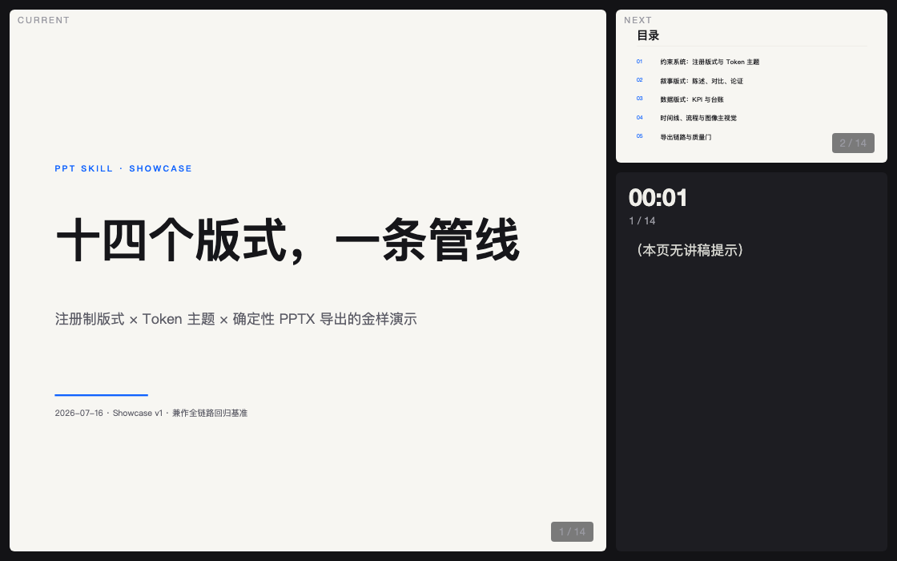

# zifeiyu-ppt-skill

> 生成锁定设计系统的网页 PPT，并**确定性导出可编辑 PPTX** 的 Agent Skill。
>
> English: [README.en.md](README.en.md)
>
> An agent skill that generates design-locked HTML slide decks and deterministically exports them to editable PPTX. Works with Claude Code, Codex, and other file-capable coding agents.

一句话说清楚它和同类项目的区别：**别人的网页 PPT 很美但导不出 .pptx，通用 HTML→PPTX 翻译又太脆——这里用「风格库独立版式注册制 + 浏览器实测驱动映射」同时拿到两者**：每页声明封闭集合内的 `data-layout` 与 `data-role`，导出器在浏览器里实测渲染几何后按固定比例（1280×720 → 960×540pt）写进 pptxgenjs，结果可预期、可回归测试。

## 风格库（全 12 套 `ready` 风格 · 共 207 个注册版式）

按 [风格库设计稿](docs/superpowers/specs/2026-10-08-style-library-design.md) 规划的全部 **12 套风格（A–L，覆盖 5 大分组）** 已全量交付并全部验证 `ready`，每种拥有完全独立的版式几何与视觉语言，开场先打开交互式风格画廊 [docs/styles/index.html](docs/styles/index.html) 筛选、对比、选定一种：

| 风格 | ID | 分组 | 版式数 | 视觉特征 | 推荐场合 |
|---|---|---|---|---|---|
| **A 杂志 · 暖纸** | `magazine` | 编辑排印 | 18 | 暖纸墨字、思源宋大标题、Playfair 斜体数字、柠檬黄单点强调 | 分享、宣传、人文 |
| **B 瑞士 · 网格** | `swiss` | 商务理性 | 17 | 极细无衬线巨字、单一克莱因蓝、严格网格与色块、蓝/墨双态页 | 数据、发布、技术 |
| **C 发布会 · 暗场** | `keynote` | 舞台冲击 | 18 | 近黑底、满版压暗写真、大字居中、暖黄强调、深色圆角卡片 | 路演、发布、大屏演讲 |
| **D 报刊 · 版面** | `broadsheet` | 编辑排印 | 17 | 暖报纸底、报头粗细双线、竖分栏线、重宋体标题、暗红栏目名 | 工作汇报、机构材料、高密度内容 |
| **E 大字报 · 粗野** | `poster` | 舞台冲击 | 17 | 荧光绿 / 纯黑 / 米白三色冲撞、撑满画面的粗黑巨字、硬阴影照片块 | 招募、活动宣传、社群分享 |
| **F 柔和 · 产品** | `soft` | 商务理性 | 17 | 浅灰底白色圆角卡片、暖橙强调、悬浮数据投影卡、连线步骤点 | 产品介绍、合作提案、企业沟通 |
| **G 摄影集 · 画册** | `photobook` | 影像叙事 | 18 | 照片为主角、文字退到图注、胶片条封面、半透明压暗数字条 | 空间/活动宣传、年度回顾、画册 |
| **H 咨询 · 白皮书** | `consulting` | 商务理性 | 17 | 追踪标签 + 结论式标题 + 编号图表 + 出处、深海军蓝、燕尾流程 | 汇报、提案、尽调 |
| **I 日式 · 极简** | `zen` | 东方人文 | 17 | 和纸大留白、思源宋体 Light 竖排、全页单粒朱砂圆点、Inter 超细数字 | 品牌、文化、设计分享 |
| **J 拼贴 · 手账** | `scrapbook` | 影像叙事 | 17 | 牛皮纸底、倾斜拍立得、彩色半透明和纸胶带、便利贴、霞鹜文楷 | 社群、活动回顾、校园、生活方式 |
| **K 新中式 · 东方** | `oriental` | 东方人文 | 17 | 宣纸米色、双边细线书框、极粗宋体竖排 + 霞鹜文楷、朱砂印章、去饱和影像 | 文旅、政务、传统文化、节庆 |
| **L 工程制图** | `datum` | 商务理性 | 17 | 工程图纸框与裁切角标、三格图签栏、克莱因蓝标注、底部锚定、足量配图 | 技术汇报、工程评审、架构设计 |

> 注：金样图集使用确定性抽象配图（`gen-art.mjs`）；实际演示中 `photobook` / `scrapbook` / `oriental` 等风格置入真实照片后质感更佳。旧版 legacy 24 版式 × 3 主题保留作向后兼容。



## 核心特性

- **风格包 × 20 页面角色解耦**：12 个核心角色（`cover / agenda / section / statement / kpi / compare / points / process / timeline / image / image-text / closing`）+ 8 个扩展角色（`bars / table / gallery / cycle / matrix / system / video / audio`）。校验器、导出器、动画层只认角色与骨架声明属性，新增风格零导出维护成本。
- **四格式一键交付链**：HTML 演示 → 可编辑 PPTX（支持 `--native-charts` 原生条形图与实验性 `--embed-fonts` 字体嵌入）→ 矢量 PDF → 逐页 PNG，HTML 是唯一源文件。
- **三道机器质量门**：
  - `validate.mjs` 执行 **R1–R16** 量化规则（版式注册、类名白名单、画布溢出分档建议、字号下限 16px、文本碰撞、数据出处与条形比例诚实、对比度下限、媒体契约、占位符拦截、节奏控制、PPTX 导出一致性），error 即阻断交付；
  - `check-style.mjs` 守住风格包完整性（核心角色覆盖、金样↔注册表一致、骨架 class 全定义）；
  - `check-pptx.mjs` 在导出后检查 OOXML 包结构、关系与图表 XML；`npm run regress` 守住全部金样的像素回归基线。
- **确定性字体子集**：思源黑 VF / 思源宋（Light–Heavy）/ 霞鹜文楷（LXGW WenKai）/ Inter / Playfair Display / JetBrains Mono 按 deck 实际用字裁切为 `.woff2` 随目录分发，`file://` 直接可用、三端渲染一致。
- **视频与音频一等公民**：`<video>` / `<audio>` 进入测量/校验/导出全链路，poster 锁定静止帧，PPTX 原生嵌入媒体。
- **交互式风格画廊**：打开 [docs/styles/index.html](docs/styles/index.html) 支持按分组/场合筛选、一键复制建稿命令、点击卡片查看多页金样灯箱，以及「同内容跨风格对比」。
- **演讲者模式 & 交付后微调**：演示按 `S` 开双窗演讲台（当前页 + 下页预览 + 计时器 + 讲稿高亮）；浏览器打开 `index.html?edit=1` 可就地改字并导出新 HTML；`import-theme.mjs` 一键从企业 `.pptx` 提取品牌 token。

## 安装

```bash
# 方式一：skills CLI
npx skills add https://github.com/ye4wzp/zifeiyu-ppt-skill --skill zifeiyu-ppt-skill

# 方式二：手动克隆
git clone https://github.com/ye4wzp/zifeiyu-ppt-skill ~/.claude/skills/zifeiyu-ppt-skill
cd ~/.claude/skills/zifeiyu-ppt-skill && npm install
```

依赖：Node.js ≥ 18；首次使用 Playwright 需 `npx playwright install chromium-headless-shell`（国内网络可加 `PLAYWRIGHT_DOWNLOAD_HOST=https://cdn.npmmirror.com/binaries/playwright`）；字体源文件一次性拉取 `node scripts/fetch-fonts.mjs`（全部 SIL OFL，跳过则回退系统字体）。PPTX 几何比对可选装 LibreOffice + poppler。

## 使用

对 Claude Code / Codex 说「做一个 XX 主题的 PPT」即可进入 8 步工作流：澄清定档 → 选风格 → 事实核查 → 建 deck → 2 页样张门 → 批量填充 → 机器校验 → 视觉自检与导出。

常用命令：

```bash
node scripts/new-deck.mjs <deck-dir> --style soft            # 从 12 套风格库任选建稿（magazine/swiss/keynote/broadsheet/poster/soft/photobook/consulting/zen/scrapbook/oriental/datum）
node scripts/subset-fonts.mjs <deck-dir>                     # 生成 deck 内字体子集（改字后重跑）
node scripts/validate.mjs <deck-dir> [--office]              # 机器校验 R1–R16
node scripts/render-png.mjs <deck-dir>                       # 逐页渲染截图
node scripts/export-pdf.mjs <deck-dir>                       # 矢量 PDF（960×540pt）
node scripts/export-pptx.mjs <deck-dir> --native-charts      # 可编辑 PPTX（含原生条形图；可选 --embed-fonts）
node scripts/check-pptx.mjs <deck-dir>/deck.pptx             # OOXML 产物结构门
node scripts/import-theme.mjs <企业模板.pptx> <name>          # 企业模板 → 品牌主题
node scripts/style-gallery.mjs                               # 重新生成交互式风格画廊与 gallery.png
node scripts/sync-skill.mjs [--check]                        # 同步/检查 ~/.claude/skills 与 ~/.agents/skills
npm test && npm run regress                                  # 单元测试 + 全金样像素回归
```

演示快捷键：方向键翻页 · `F` 全屏 · `S` 演讲者控制台。



## 设计原则

1. **约束换质量**：禁止从零写 HTML、禁止自造类名、颜色只经 token——R1–R16 机器门逐条拦截。
2. **测量驱动映射**：版式与元素词汇表双重封闭，导出器实测浏览器渲染几何后确定性映射到 pptxgenjs；圆角、描边、单层阴影、旋转、燕尾箭头与竖排均走 PowerPoint 原生原语，不可映射的渐变装饰经 `data-raster` 单独截图，文字永远可编辑。
3. **画布契约**：1280×720 逻辑画布，`px ÷ 96 → in`、`px × 0.75 → pt`，精准对齐 PowerPoint 16:9（960×540pt）。

## 已知边界

- 默认 PPTX 按风格 `manifest.json` 映射为 Office 系统通用字体（如 `Microsoft YaHei` / `SimSun` / `Segoe UI`），以保证跨平台打开不跑版；`--embed-fonts` 为实验性字体嵌入选项（详见 [references/pptx-export.md](references/pptx-export.md)）。
- LibreOffice 仅作几何验证，最终中文字体渲染以 WPS / PowerPoint 实开为准。
- 不适合超大数据表或多人在线协同编辑场景。

## 致谢

方法论受以下项目启发（均为独立实现，未复用其代码）：
[guizang-ppt-skill](https://github.com/op7418/guizang-ppt-skill) ·
[huashu-design](https://github.com/alchaincyf/huashu-design) ·
[html-ppt-skill](https://github.com/lewislulu/html-ppt-skill) ·
[guizang-social-card-skill](https://github.com/op7418/guizang-social-card-skill)

## License

[MIT](LICENSE)
